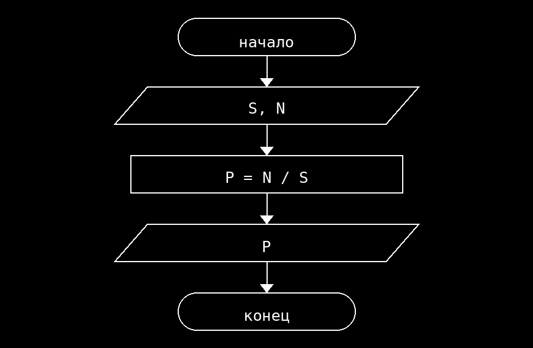

**Условие**
Найти плотность населения по заданной площади территории и числу жителей: P = N / S. Площадь должна быть больше нуля.

**Блок схема**

**Контрольный пример**
Ввод: 50 10000
Вывод: Плотность населения: 200.00 человек на единицу площади
